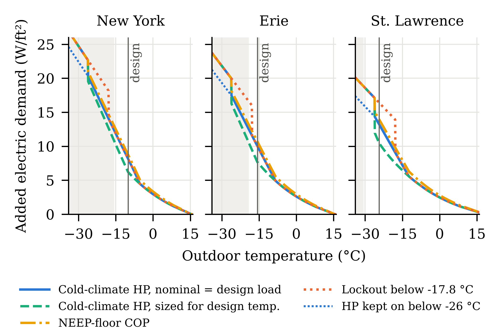
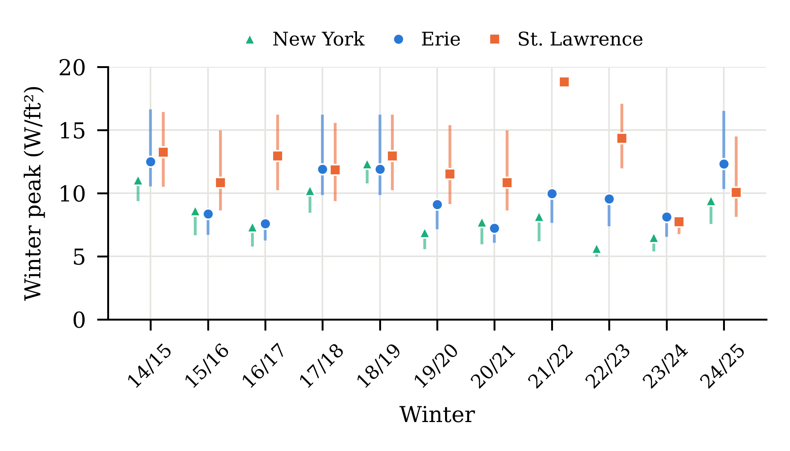

# Cold-Morning Peaks from Electrified School Heating in New York State: Heat-Pump Choice, Weather-Year Risk and Short-Duration Storage

Shokirdzhon Ismoilov — OFTO Energy Foundation, Brooklyn, NY, USA — shokir@oftoenergy.org

**Abstract—**Electrifying space heating is moving New York toward a winter-peaking grid, yet the share of that peak that comes from individual building types is rarely resolved. This paper estimates the electric demand that the school building stock of three New York counties (New York, Erie and St. Lawrence) would add on cold school mornings if all school heating were served by air-source heat pumps with resistance backup. A temperature-dependent heating signature of the ComStock school stock is driven by 11 winters (2014/15−2024/25) of hourly NOAA station temperature under five heat-pump cases. The added peak is 322, 392 and 49 MW (12.3−18.8 W/ft²), 5.2−7.1 times the mean occupied-hour demand and 31−59% above the peak of a median winter. Heat-pump choice moves the Erie peak from 330 MW (capacity sized for the design temperature) to 521 MW (compressor lockout at −17.8 °C); below about −26 °C every rated case falls back to resistance. A battery that caps the peak by 10% needs 1.2−1.9 h of storage and is called on at most 7 school days in 11 winters, but a 20% cap needs 5.2 h in Erie. School electrification plans should use multi-year weather, specify cold-climate heat-pump performance and treat short-duration storage as a shallow peak cap.

**Index Terms—**Building electrification, heat pumps, peak demand, energy storage, schools, winter reliability

## I. INTRODUCTION

New York's electric peak occurs in summer today, but heating electrification would move it to winter: a statewide study finds the winter peak overtakes the summer peak at about 25% building and vehicle electrification and reaches 83 GW at full electrification, against 34 GW today, driven by heating in extreme cold [1]. Similar winter-peak growth has been reported for space heating at national scale [2] and for residential heating in Texas [3]. These studies treat buildings as one or two sectors. Schools are a distinct segment: a large, publicly owned stock with a common budget process, a narrow occupied window that starts on the coldest hours of the morning, and a growing role as community shelters during winter outages. Their contribution to the cold-weather peak, and how it depends on the heat pump chosen and on the weather year used for planning, has not been quantified.

This paper asks three questions for the school stock of three New York counties with different climates: New York County (Manhattan), Erie County (Buffalo) and St. Lawrence County (North Country). (i) How large is the electric peak that full heat-pump conversion of school heating would add on school mornings? (ii) How much does it depend on heat-pump cold performance and sizing, and on the winter used for planning? (iii) How much of it can a short-duration battery remove? The calculation reuses the heating signature and heat-pump curve of the author's single-school shelter sizing study [10], which is under review; that study sizes storage for one school through a 72-h outage and does not address grid demand. The fleet-level question, the multi-year weather record, the sizing and lockout cases and the peak-capping analysis are new here.

## II. DATA AND METHOD

### A. Building stock and heating signature

The school stock is taken from ComStock 2025 Release 3 county aggregates for primary and secondary schools [4]: 26.2, 31.3 and 2.6 million ft² of represented floor area in New York, Erie and St. Lawrence counties. Thermal heating demand per unit area, from the ComStock ideal-load upgrade, was fitted in [10] against airport station temperature in occupied hours (weekdays 08:00−15:59, November−March) with a one-slope change-point model, giving balance temperatures of 15.5−18.5 °C and R² of 0.74−0.85. The fleet thermal demand in hour t is

    Q_{t} = Σ_{b} A_{b} s_{b} max(0, T_{bal,b} − T_{t})        (1)

where A_{b} is the floor area, s_{b} the slope and T_{bal,b} the balance temperature of school type b, and T_{t} the outdoor temperature.

### B. Weather

Hourly air temperature for winters 2014/15 to 2024/25 (November to March) comes from NOAA Integrated Surface Database records [8] at Central Park (KNYC), Buffalo Niagara (KBUF) and Massena (KMSS). Reports flagged suspect or erroneous are removed, reports within an hour are averaged and gaps of up to 3 h are interpolated; 0.69%, 0.00% and 0.04% of occupied hours remain missing and are dropped. As a check, the Central Park minimum of the record, −18.3 °C on 14 February 2016, matches the −1 °F reported for that morning. Occupied hours exclude U.S. federal holidays, 24 December−1 January and the week of Presidents' Day, an approximation of New York school calendars (for example, New York City schools were closed 16−20 February 2015); a run with every weekday occupied is reported as a sensitivity. This leaves 8,175−8,232 occupied hours per county. The design temperature T_{des} is the 1st percentile of winter hourly temperature: −10.0, −15.7 and −24.4 °C.

### C. Heat-pump cases

All school heating is assumed to move to air-source heat pumps with electric-resistance backup; the result is the added electric demand, not the net change in the school's total load. The heat-pump nominal thermal capacity is

    H = Σ_{b} A_{b} s_{b} max(0, T_{bal,b} − T_{des}) / k(T_{des})^{δ}        (2)

with k(T) the capacity fraction at temperature T. The electric demand is

    P_{t} = min(Q_{t}, k(T_{t})H)/COP(T_{t}) + Q_{t} − min(Q_{t}, k(T_{t})H)        (3)

Five cases are compared. CC (main): a cold-climate curve with COP 3.37, 2.33, 1.98 and 1.49 at 8.3, −8.3, −15 and −26.1 °C and capacity 1.03, 0.77, 0.69 and 0.51 of nominal [6], nominal capacity equal to the design-temperature load (δ = 0, the rule of [10]) and resistance only below the coldest rated point. CC-full: as CC with δ = 1, so the derated capacity meets the design load. NEEP: CC with COP scaled to 1.75 at −15 °C, the qualifying floor of the NEEP cold-climate specification [7]. Lockout: CC with the compressor off below −17.8 °C (0 °F), the behavior of the standard-performance heat-pump rooftop unit modeled by ComStock [5]. CC-hold: CC with the −26.1 °C point held at colder temperatures, an optimistic bound for units that keep running in deep cold.

### D. Peak capping with storage

Let P_{max} be the highest occupied-hour demand over all winters. A battery of power xP_{max} holds demand at (1 − x)P_{max} if its usable energy covers the worst school day:

    E = max_{d} Σ_{t∈d} max(0, P_{t} − (1 − x)P_{max})        (4)

Nameplate energy is E/(η_{d}u), with discharge efficiency η_{d} = 0.85^{0.5} from an 85% round trip [9] and usable fraction u = 0.9; duration is nameplate energy over power. Discharge assumes the day's demand is known (perfect foresight), and recharge is assumed in the 16 unoccupied hours that follow; its average power is reported against the cap. Code and data sources are listed in the data availability note.

## III. RESULTS

### A. Why the peak is steep

Fig. 1 shows the added demand per square foot as a function of outdoor temperature. Between 0 and −5 °C the heat pumps carry the load at a COP near 2.5 or above and each degree adds 0.21−0.29 W/ft². Around the design temperature the derated capacity no longer covers the load (in the CC case already somewhat above it, since nominal capacity equals the design load) and resistance takes the rest at COP 1, so each degree adds 0.71−0.83 W/ft², 2.6−3.9 times as much. The lockout case jumps at −17.8 °C, and every case except CC-hold converges on pure resistance below −26.1 °C. Where the coldest occupied hours fall on this curve decides the peak.

*Fig. 1. Added electric demand of the county school stock per square foot versus outdoor temperature for the five heat-pump cases. Vertical line: design temperature; shaded: colder than any occupied hour in 2014/15–2024/25.*

### B. Peak demand and heat-pump choice

Table I lists the peaks. With the main CC case the school stock adds 322 MW in New York County, 392 MW in Erie and 49 MW in St. Lawrence, or 12.3, 12.5 and 18.8 W/ft². The peaks fall at 08:00 on 31 January 2019 (−15.6 °C), 23 February 2015 (−19.1 °C) and 21 January 2022 (−30.6 °C) and are 5.2−7.1 times the mean occupied-hour demand, so the added energy is modest but its peak is sharp. Resistance supplies 59−61% of the peak in New York and Erie and all of it in St. Lawrence.

Heat-pump choice matters most where the coldest school mornings sit between −17.8 and −26 °C. In Erie, sizing for the design temperature (CC-full) lowers the peak to 330 MW and the NEEP floor raises it to 413 MW, while the lockout raises it to 521 MW, 33% above CC. In New York County no occupied hour was colder than −15.6 °C, so the lockout never acts and only sizing and COP move the peak (281−339 MW). In St. Lawrence the peak hour is below the coldest rated point, so all four rated cases give 49 MW; only a unit that keeps running in deep cold (CC-hold) lowers it, to 42 MW. If schools were open on every weekday, the Erie peak would rise to 467 MW (+19%), because the coldest Erie school morning of the record fell in the Presidents' Day week of 2015; the other two counties are unchanged.

**TABLE I. ADDED PEAK DEMAND OF THE COUNTY SCHOOL STOCK**

Peaks in MW (school calendar). Max / median: 11-winter peak over median winter peak, CC case.

| County | T_{des} (°C) | CC | CC-full | NEEP | Lockout | CC (W/ft²) | Max / median |
|---|---|---|---|---|---|---|---|
| New York | −10.0 | 322 | 281 | 339 | 322 | 12.3 | 1.51 |
| Erie | −15.7 | 392 | 330 | 413 | 521 | 12.5 | 1.31 |
| St. Lawrence | −24.4 | 49 | 49 | 49 | 49 | 18.8 | 1.59 |

### C. Weather-year risk

Fig. 2 shows the peak of each winter. Winter peaks span 5.6−12.3 W/ft² in New York, 7.2−12.5 in Erie and 7.7−18.8 in St. Lawrence. The 11-winter maximum is 1.31, 1.51 and 1.59 times the median winter peak in Erie, New York and St. Lawrence. A plan based on a typical winter, or on a single simulation year, would understate the school peak by a third to more than a half.

*Fig. 2. Peak added demand of each winter, CC case (markers), with the range from CC-full to Lockout (bars); school calendar.*

### D. Short-duration storage

Table II gives the battery needed to cap the CC peak. The first 10% is cheap in energy: 32.2, 39.2 and 4.9 MW with 1.52, 1.93 and 1.21 h, or 1.9−2.3 kWh per 1,000 ft², discharged on 1−7 school days in 11 winters. Deeper caps diverge by climate. In Erie a 20% cap needs 5.23 h (409 MWh) and is used on 12 days, because Buffalo cold outbreaks hold demand near the peak through the whole school day; in New York it needs 2.33 h. The 1.21-h duration in St. Lawrence is a single-hour event: its peak is one very cold morning hour. Recharge at the 20% cap draws on average at most 8.0% of the cap over the following 16 h.

**TABLE II. BATTERY TO CAP THE CC PEAK BY A FRACTION X**

Energy is nameplate; days used: school days with discharge in 11 winters (school calendar).

| x | County | Power (MW) | Energy (MWh) | Duration (h) | Days used |
|---|---|---|---|---|---|
| 10% | New York | 32.2 | 49 | 1.52 | 1 |
| 10% | Erie | 39.2 | 75 | 1.93 | 7 |
| 10% | St. Lawrence | 4.9 | 6 | 1.21 | 2 |
| 20% | New York | 64.5 | 150 | 2.33 | 3 |
| 20% | Erie | 78.3 | 409 | 5.23 | 12 |
| 20% | St. Lawrence | 9.8 | 12 | 1.21 | 2 |
| 30% | New York | 96.7 | 277 | 2.86 | 8 |
| 30% | Erie | 117.5 | 787 | 6.70 | 19 |
| 30% | St. Lawrence | 14.8 | 24 | 1.63 | 7 |

## IV. DISCUSSION AND LIMITATIONS

For grid planners the results point to three inputs that change the school peak by tens of percent: the weather years used, the cold-weather rating and lockout setting written into heat-pump procurement, and whether units are sized to the derated or the nominal capacity. These are procurement choices made school by school, which makes them a lever that utilities and school districts can set together. Short-duration batteries are a credible tool for the top tenth of the peak, which occurs on a few mornings per decade; beyond that, upstate cold outbreaks call for long durations. A school battery held as a shelter reserve [10] could provide the first 10% only if the discharge does not compromise readiness for an outage that may follow the same cold spell; the author's forecast study [11] addresses that readiness decision and could set when a peak-capping discharge is allowed.

The estimates have limits. ComStock is simulated stock, not metered schools, and its represented area may differ from the actual inventory. The signature uses occupied hours only, so a morning warm-up after a night setback, which would raise the peak, is not modeled, nor is overnight heating during recharge. The COP curve is generic and below the coldest rated point its behavior is bracketed rather than known. School calendars are approximated. Storage dispatch assumes perfect foresight. The peaks are county-level and non-coincident across counties, and they are not netted against existing electric heating or the summer peak.

## V. CONCLUSION

Converting the heating of a county's school stock to air-source heat pumps adds a sharp cold-morning peak of about 12.3−18.8 W/ft² (392 MW for Erie), set by the coldest school morning of the decade rather than a typical winter, and shifted by up to a third by the heat-pump lockout and sizing rules. A battery can remove its top 10% with under 2 h of storage; deeper caps are a long-duration problem in cold upstate counties. Specifying cold-climate heat pumps sized for the design temperature, and planning on multi-year weather, are the low-cost first steps.

Data availability: inputs are public (ComStock 2025 R3, NOAA ISD). The analysis code, unit tests and result tables are in the author's repository [ARCHIVE LINK — to be added by the author].

Generative AI disclosure: Claude (Anthropic) was used to write and test the analysis code, run the calculations, draw the figures and draft the text of all sections under the author's direction. The author chose the research question and cases, reviewed the code, results and text, and takes full responsibility for the content. [AUTHOR TO CONFIRM WORDING]

## REFERENCES

[1] Y. Wu, M. Waite, T. Conlon, and V. Modi, “The role of electrification induced peak loads and gas infrastructure constraints on decarbonization pathways in New York State,” Energy Strategy Rev., vol. 44, Art. no. 100985, 2022, doi: 10.1016/j.esr.2022.100985.
[2] M. Waite and V. Modi, “Electricity load implications of space heating decarbonization pathways,” Joule, vol. 4, no. 2, pp. 376–394, 2020, doi: 10.1016/j.joule.2019.11.011.
[3] P. R. White, J. D. Rhodes, E. J. H. Wilson, and M. E. Webber, “Quantifying the impact of residential space heating electrification on the Texas electric grid,” Appl. Energy, vol. 298, Art. no. 117113, 2021, doi: 10.1016/j.apenergy.2021.117113.
[4] A. Parker et al., “ComStock reference documentation: Version 1,” Nat. Renewable Energy Lab., Golden, CO, USA, NREL/TP-5500-83819, 2023, doi: 10.2172/1967948; ComStock 2025 Release 3 (AMY2018) dataset.
[5] J. Kim and C. CaraDonna, “ComStock measure scenario documentation: Standard performance heat pump RTU with new windows,” Nat. Renewable Energy Lab., Golden, CO, USA, NREL/TP-5500-95006, 2025.
[6] Nat. Renewable Energy Lab., “ResStock documentation: Heat pump upgrades tutorial.” [Online]. Available: https://resstock.readthedocs.io (accessed Oct. 20, 2026).
[7] Northeast Energy Efficiency Partnerships, “Cold climate air source heat pump specification, version 4.0,” 2023.
[8] NOAA National Centers for Environmental Information, “Integrated Surface Database (ISD),” [Online]. Available: https://www.ncei.noaa.gov/pub/data/noaa/ (accessed Nov. 11, 2026).
[9] Nat. Renewable Energy Lab., “2024 Annual Technology Baseline: Commercial battery storage.” [Online]. Available: https://atb.nrel.gov (accessed Oct. 21, 2026).
[10] S. Ismoilov, “Can an electrified school stay open in a blizzard? Solar-plus-storage sizing for winter shelter operation under cold-battery and snow constraints in New York State,” submitted for publication.
[11] S. Ismoilov, “Charge before the storm: Forecast-informed battery readiness for school winter shelters in New York State,” submitted for publication.
